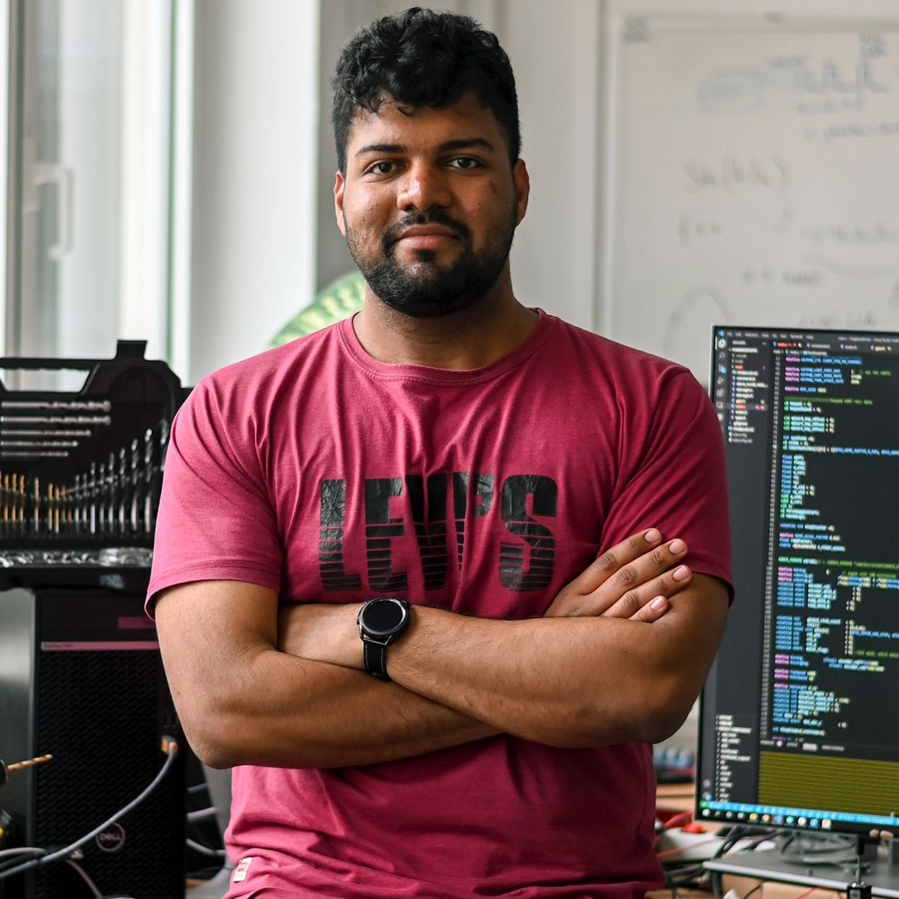

 
Hello! I'm Pranav Kedia, a Ph.D. researcher at the <a href="https://www.cps.uni-konstanz.de/">cyber physical group</a> supervised by <a href="https://heikohamann.de/">Prof. Dr. Heiko Hamann</a> at the <a href="https://www.uni-konstanz.de/">University of Konstanz</a>, where I'm affiliated with the  <a href="https://www.exc.uni-konstanz.de/collective-behaviour/">Centre for the Advanced Study of Collective Behaviour</a>. I am working on a swarm of autonomous sailboats optimized for long-duration endurance. This research has been a combination of learning about sailing and applying my skills and knowledge in Embedded systems and Robotics. Before that, I built a waggle-dance robot bee for the EU H2020 project <a href="https://www.hiveopolis.eu/">Hiveopolis</a> in <a href="https://www.mi.fu-berlin.de/inf/groups/ag-ki/members/Professoren/Tim_Landgraf.html">Prof. Dr. Tim Landgraf</a>'s <a href="https://bioroboticslab.github.io/website/">Biorobotics Lab</a> at <a href="https://www.fu-berlin.de/en/index.html">FU Berlin</a>. I did my master's in electronics and communication (embedded systems) at <a href="https://www.iiitb.ac.in/">IIIT Bangalore</a>, in <a href="https://www.iiitb.ac.in/faculty_page.php?name=madhavrao">Prof. Madhav Rao</a>'s <a href="https://www.iiitb.ac.in/sarl/sarl.html">Surgical and Assistive Robotics Lab</a>, and spent summer 2019 in <a href="https://sites.google.com/iitb.ac.in/arpitasinha">Dr. Arpita Sinha</a>'s <a href="http://www.sc.iitb.ac.in/robotics/people.html">ARMS Lab</a> at IIT Bombay.
  
My research sits where field robotics meets embodied intelligence: robots that cope with real wind, waves and animals over long deployments, and, next, robots that learn models of the world they act in.

<h2 align="left"> Research and other interests</h2>

 I am interested in <strong>field and marine robotics</strong> and <strong>long-term autonomy</strong>: robots that keep working for weeks at sea, not minutes in a lab. I am drawn to <strong>physical and embodied intelligence</strong>, where a robot's body, energy and environment do part of the computing, and to <strong>bio-inspired multi-robot systems</strong>: groups of robots that coordinate without fitting the textbook picture of a swarm. Next, I want to explore <strong>world models</strong> that let robots predict and plan in messy, changing conditions. Building novel robots, and getting them out of the lab, has always excited me.
 

 Apart from my work, I enjoy traveling and learning about new cultures and languages. I like to find interconnections and variations of languages in different places. I love to sketch and paint. I am also an avid reader of world politics and history.

 

## Latest



## News



 

